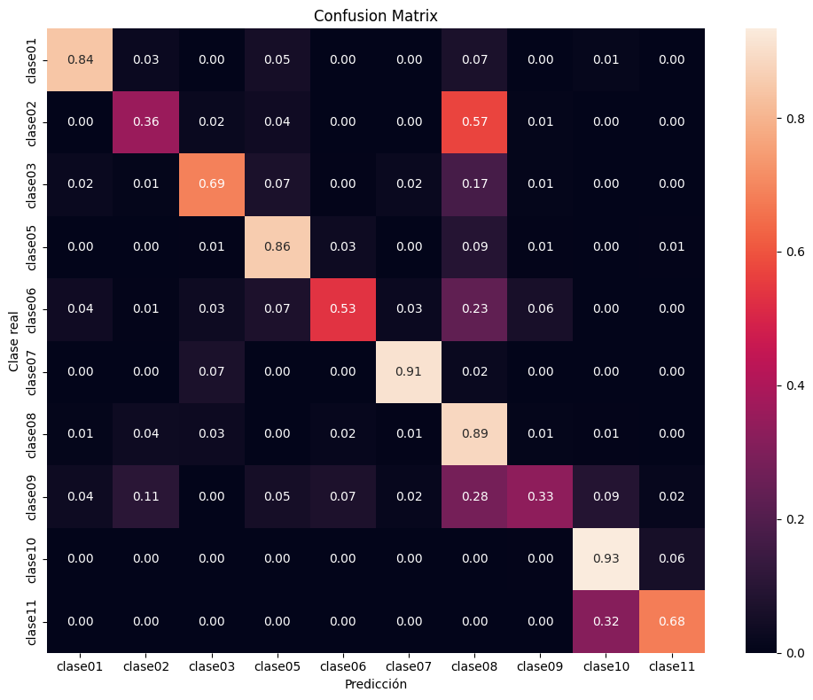
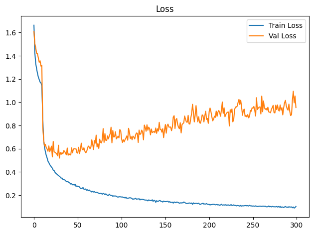
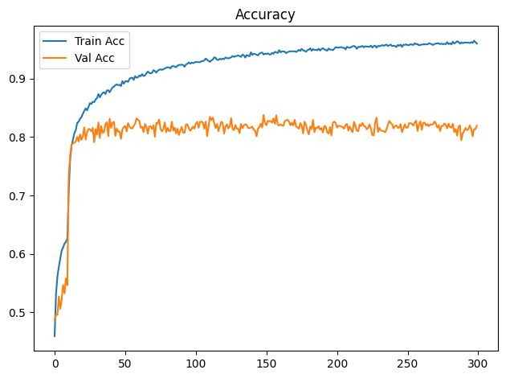

# Informe de análisis del entrenamiento de clasificación de perfiles y fragmentos de vasijas

Fecha de revisión: **8 de octubre de 2026**. Análisis retrospectivo de resultados guardados; no se ejecutó un nuevo entrenamiento ni se modificaron los modelos.

## Dictamen

Los experimentos muestran capacidad para clasificar perfiles completos: el máximo acierto de prueba de la serie de diez clases es **92,55 %**. Al incluir fragmentos sintéticos, el máximo registrado es **81,27 %**, con **F1 macro de 0,72**. La clasificación unificada presenta dificultades importantes en las clases 2 y 9 y una brecha marcada entre entrenamiento y validación al prolongar el entrenamiento.

Estas cifras describen las ejecuciones conservadas, pero **no permiten validar las comparaciones “ponderado frente a no ponderado” ni “congelado frente a descongelado”**: los parámetros de control no están conectados a esas operaciones. También hay diferencias entre los datos disponibles hoy y los usados entonces. Antes de elegir un modelo definitivo, corresponde corregir la configuración efectiva y restablecer la trazabilidad del conjunto de evaluación.

## Alcance y evidencia

Se revisaron las **27 ejecuciones numeradas**, nueve por serie, sus parámetros inyectados, logs por época, reportes de clasificación y el código de entrenamiento y partición. Se priorizan estas series comparables; los notebooks antiguos, las ejecuciones “default” y la ejecución adicional no numerada no forman parte de la tabla comparativa.

- [Serie unificada](../../output/experiments/): perfiles completos y recortes.
- [Serie de completos](../../output/experiments%20(completos)/): diez clases, sin clase 4.
- [Serie con clase 4](../../output/experiments%20(con_clase4)/): once clases.
- [Entrenamiento](../../src/vasijas/entrenamiento_cnn.py), [ejecutor de experimentos](../../scripts/ejecucion.py), [partición](../../src/vasijas/split_dataset.py) y [notebook de partición agrupada](../../notebooks/02.preparacion/12.Division_de_union_en_train_val_y_test.ipynb).
- [Tabla de métricas en CSV](metricas_experimentos.csv) y [evidencia por ejecución en JSON](evidencia_experimentos.json), con rutas originales, parámetros, métricas por clase y resúmenes de convergencia.

La exactitud se toma de “Test Acc”, impresa con cuatro decimales; precision, recall y F1 provienen del reporte guardado con dos decimales. No se reconstruyeron predicciones individuales ni se recalcularon métricas con los pesos. El código actual ayuda a explicar las salidas, pero no se dispone de una versión del módulo importado fijada por cada ejecución.

## Datos y validez de la evaluación

| Serie histórica | Clases | Train | Validación | Test | Total |
|---|---:|---:|---:|---:|---:|
| Completos | 10 | 749 | 161 | 161 | 1.071 |
| Completos con clase 4 | 11 | 756 | 162 | 163 | 1.081 |
| Unificado | 10 | 14.231 | 3.059 | 3.059 | 20.349 |

Los tamaños históricos proceden de las salidas de los notebooks, no de asumir que la metadata actual es la misma.

La metadata de [data/11.unificado](../../data/11.unificado/metadata.csv) tiene hoy 20.700 filas y 1.242 identificadores de perfil: 1.081 perfiles con 19 imágenes cada uno y 161 registros sin clase con una imagen cada uno. Cada perfil clasificado aporta un completo y 18 recortes: desde base y tope, con avances de 10 % a 90 %. Al excluir la clase 4 (190 imágenes) y los registros sin clase (161), quedan 20.349 imágenes de 1.071 perfiles, en concordancia con la serie unificada. No se encontraron identificadores de imagen duplicados ni identificadores de perfil vacíos en esta metadata.

El aumento de 1.071 a 20.349 imágenes **no equivale a incorporar nuevas vasijas independientes**. Son vistas relacionadas de los mismos perfiles. El conjunto unificado contiene aproximadamente 5,26 % de completos y 94,74 % de fragmentos sintéticos; por eso su métrica agregada está dominada por los recortes. No hay una evaluación separada de fragmentos arqueológicos reales que permita extenderles estos resultados.

El código y el notebook de preparación dividen por `id_perfil_completo`, estratifican por clase y propagan la misma partición a todos sus recortes. Este diseño evita que un perfil y sus fracciones se repartan entre train y test. Sin embargo:

- **No existe actualmente** `data/12.unificado_divididos_en_train_val_y_test`, directorio que las nueve ejecuciones unificadas declaran haber utilizado. No se pudo auditar directamente el solapamiento histórico de identificadores entre particiones.
- La [metadata actual de completos](../../data/10.cuadrados_divididos_en_train_val_y_test/metadata.csv) tiene 1.242 filas, incluyendo `sin_clase`, y particiones de 869/186/187. **No reproduce los tamaños históricos** de ninguna de las dos series de completos.
- Los soportes de test del unificado son exactamente 19 veces los de completos sin clase 4. Es consistente con la partición agrupada, pero no demuestra por sí solo que coincidan los identificadores históricos.

Las clases 8 y 10 concentran **59,01 % del test** en las series sin clase 4. La clase 10 representa 32,92 %: ese sería el acierto de predecir siempre dicha clase. El modelo unificado supera ampliamente ese punto de referencia, aunque la exactitud global oculta diferencias entre clases.

## Configuración declarada y configuración efectiva

Se utiliza ResNet-18 preentrenada, con una nueva capa final, Adam y entropía cruzada. Las imágenes se llevan a 224 × 224 y se normalizan con los valores de ImageNet. En las ejecuciones numeradas se configuran volteo horizontal, rotación de ±15° y escala de 0,8 a 1,0; las transformaciones aleatorias se aplican solo a train.

| Exp. | Batch | LR de la cabeza efectivo | Flip | Épocas | Etiqueta histórica |
|---|---:|---:|---:|---:|---|
| 01 | 16 | 1e-3 | 0,5 | 30 | base |
| 02 | 32 | 1e-3 | 0,5 | 30 | base |
| 03 | 16 | 1e-3 | 0,5 | 30 | weighted |
| 04 | 32 | 1e-3 | 0,5 | 30 | weighted |
| 05 | 16 | 1e-4 | 0,5 | 300 | weighted_unfreeze |
| 06 | 16 | 1e-4 | 0,8 | 300 | weighted_unfreeze |
| 07 | 16 | 3e-4 | 0,5 | 300 | weighted_unfreeze |
| 08 | 16 | 3e-4 | 0,8 | 300 | weighted_unfreeze |
| 09 | 16 | **1e-5** | 0,5 | 300 | nombre indica 3e-5 |

**Ponderación no aplicada.** Las 27 ejecuciones llaman a `crear_criterio_entropia_cruzada()` sin pesos. La función disponible devuelve `nn.CrossEntropyLoss()`. `USE_CLASS_WEIGHTS` no se consulta. Las parejas 01/03 y 02/04 tienen la misma configuración efectiva identificada; sus diferencias no son evidencia del efecto de ponderar clases.

**Descongelación aplicada en todas las ejecuciones.** `ENABLE_UNFREEZE=False` no impide pasar `UNFREEZE_EPOCH=10` a la función de entrenamiento. Los 27 logs confirman descongelación de `layer4` en la **época 11** (índice de configuración desde cero). No hay un control completamente congelado en esta matriz.

**LR del backbone calculado antes de la inyección.** La celda original calcula `BACKBONE_LR = LR * BACKBONE_LR_FACTOR` con LR inicial de 1e-3. Papermill cambia después LR, sin recalcular la variable derivada. Los logs confirman **1e-4 para layer4 en todas las ejecuciones**. Para 05/06 equivale al LR de la cabeza y para 09 es diez veces mayor, en lugar de ser su décima parte.

**Parámetros sin conexión y reproducibilidad incompleta.** La celda de dataloaders no transmite `NUM_WORKERS`; el entrenamiento no transmite `USE_AMP` ni `USE_CHANNELS_LAST`. El módulo actual activa AMP/channels-last automáticamente en CUDA. Tampoco se observa fijación explícita de semillas de Python, NumPy o Torch en las celdas ejecutadas. `SEED=42` inyectado no garantiza reproducibilidad del entrenamiento; el split se carga de metadata y no se recalcula con ese valor. `CLASES_A_PROCESAR` y `DATASET_NAME` tampoco seleccionan las entradas en esas celdas.

**Se evalúa y guarda la última época.** No se restaura el mejor estado de validación y no hay parada temprana en el bucle revisado. El nombre de guardado omite el dataset: `model_{MODEL_NAME}_{RUN_NAME}.pth`, por lo que reutilizar una carpeta entre series puede sobrescribir pesos. Existen carpetas archivadas, pero el formato guardado no incorpora configuración, clases ni identidad del split.

## Resultados comparativos

¹ F1 macro es el promedio entre clases, con igual peso por clase; está redondeado a dos decimales en la fuente. ² Tiempo calculado sumando las duraciones impresas por época, incluyendo entrenamiento y validación; excluye preparación, evaluación final y guardado. El máximo de validación corresponde a una época intermedia y **no** al modelo evaluado en test; en empates se muestra la primera época.

### Perfiles completos, diez clases

| Exp. | Épocas | Acierto test | F1 macro test¹ | Acierto val. final | Máx. val. (época) | Tiempo² |
|---|---:|---:|---:|---:|---:|---:|
| 01 | 30 | 88,82 % | 0.84 | 89,44 % | 91,93 % (19) | 3.2 min |
| 02 | 30 | 86,96 % | 0.81 | 89,44 % | 94,41 % (24) | 3.5 min |
| 03 | 30 | 89,44 % | 0.81 | 91,93 % | 93,17 % (27) | 3.2 min |
| 04 | 30 | 89,44 % | 0.81 | 88,82 % | 91,30 % (27) | 3.5 min |
| 05 | 300 | 92,55 % | 0.86 | 88,20 % | 93,79 % (21) | 34.0 min |
| 06 | 300 | 89,44 % | 0.80 | 93,17 % | 95,03 % (96) | 34.1 min |
| 07 | 300 | 92,55 % | 0.87 | 93,17 % | 95,65 % (50) | 34.0 min |
| 08 | 300 | 91,30 % | 0.88 | 91,30 % | 95,65 % (221) | 34.0 min |
| 09 | 300 | 90,68 % | 0.86 | 90,68 % | 95,65 % (147) | 34.0 min |

Los experimentos 05 y 07 empatan en 92,55 %: aproximadamente **149 aciertos de 161**, coherentes con el redondeo guardado. El mayor F1 macro es 0,88 en 08, con 91,30 % de acierto. Esto muestra que elegir por acierto o por equilibrio entre clases puede dar candidatos distintos.

Un solo error modifica el acierto en 0,62 puntos porcentuales. En la clase 9 hay solo tres perfiles de test y en la clase 1 solo cuatro; sus métricas por clase son inestables. La comparación de una ejecución por configuración no permite afirmar superioridad estadística.

### Perfiles y fragmentos sintéticos, diez clases

| Exp. | Épocas | Acierto test | F1 macro test¹ | Acierto val. final | Máx. val. (época) | Tiempo² |
|---|---:|---:|---:|---:|---:|---:|
| 01 | 30 | 78,69 % | 0.69 | 80,25 % | 80,97 % (27) | 54.3 min |
| 02 | 30 | 81,07 % | 0.71 | 79,50 % | 80,52 % (26) | 52.4 min |
| 03 | 30 | 79,60 % | 0.68 | 81,50 % | 81,66 % (20) | 55.0 min |
| 04 | 30 | 80,22 % | 0.70 | 82,02 % | 82,02 % (27) | 50.9 min |
| 05 | 300 | 81,27 % | 0.72 | 81,95 % | 83,79 % (149) | 575.8 min |
| 06 | 300 | 78,98 % | 0.70 | 81,56 % | 83,00 % (171) | 577.0 min |
| 07 | 300 | 79,50 % | 0.69 | 81,20 % | 83,39 % (94) | 581.5 min |
| 08 | 300 | 79,54 % | 0.68 | 81,37 % | 83,20 % (174) | 575.6 min |
| 09 | 300 | 78,72 % | 0.69 | 81,33 % | 83,92 % (96) | 575.2 min |

El experimento 05 tiene el mayor acierto de test observado (**81,27 %, unos 2.486/3.059**) y el mayor F1 macro guardado (0,72). El experimento 02 obtiene 81,07 % y F1 macro 0,71 con 30 épocas: la diferencia de acierto es de aproximadamente **seis imágenes**, mientras que 05 emplea unas **11 veces** más tiempo (575,8 frente a 52,4 minutos). No hay base para justificar 300 épocas por esa diferencia aislada.

Por acierto de validación de los estados finales guardados, 04 alcanza 82,02 %, por encima del 81,95 % de 05. Si se usan los máximos de validación a lo largo del entrenamiento, 09 llega a 83,92 % en la época 96, pero su estado final obtiene 78,72 % en test. Son criterios distintos: el informe identifica máximos retrospectivos, **no selecciona un ganador definitivo usando test**.

La diferencia de 11,28 puntos entre los máximos de test de completos y unificado no mide por sí sola una pérdida causada por agregar fragmentos: cambian el entrenamiento y la composición de la evaluación. Haría falta evaluar ambos modelos sobre los mismos perfiles completos y los mismos fragmentos, por separado.

### Serie histórica con clase 4

| Exp. | Épocas | Acierto test | F1 macro test¹ | Acierto val. final | Máx. val. (época) | Tiempo² |
|---|---:|---:|---:|---:|---:|---:|
| 01 | 30 | 89,57 % | 0.75 | 87,65 % | 88,27 % (17) | 3.5 min |
| 02 | 30 | 91,41 % | 0.88 | 90,12 % | 91,98 % (29) | 3.4 min |
| 03 | 30 | 87,73 % | 0.83 | 89,51 % | 90,74 % (28) | 3.2 min |
| 04 | 30 | 86,50 % | 0.82 | 84,57 % | 90,74 % (16) | 3.5 min |
| 05 | 300 | 92,02 % | 0.89 | 94,44 % | 94,44 % (300) | 34.3 min |
| 06 | 300 | 88,96 % | 0.85 | 92,59 % | 93,83 % (265) | 34.5 min |
| 07 | 300 | 93,87 % | 0.90 | 89,51 % | 93,83 % (263) | 34.5 min |
| 08 | 300 | 89,57 % | 0.85 | 88,27 % | 93,83 % (229) | 35.9 min |
| 09 | 300 | 93,25 % | 0.82 | 89,51 % | 92,59 % (282) | 37.0 min |

El máximo observado es 93,87 % en 07, con F1 macro 0,90. La clase 4 tiene **un único ejemplo de test**: acertarlo o fallarlo cambia su recall de 1 a 0. En 09, el acierto global es 93,25 %, pero el F1 de clase 4 es 0. No debe interpretarse esta serie como prueba de que la clase 4 esté resuelta ni compararse directamente con el test de diez clases, cuya composición es distinta.

## Clases y errores del modelo unificado 05

| Clase | Imágenes test | Perfiles equivalentes³ | Precisión | Recall | F1 |
|---|---:|---:|---:|---:|---:|
| clase01 | 76 | 4 | 0.76 | 0.84 | 0.80 |
| clase02 | 133 | 7 | 0.55 | 0.36 | 0.43 |
| clase03 | 209 | 11 | 0.77 | 0.69 | 0.73 |
| clase05 | 152 | 8 | 0.76 | 0.86 | 0.80 |
| clase06 | 152 | 8 | 0.79 | 0.53 | 0.64 |
| clase07 | 133 | 7 | 0.88 | 0.91 | 0.90 |
| clase08 | 798 | 42 | 0.79 | 0.89 | 0.84 |
| clase09 | 57 | 3 | 0.45 | 0.33 | 0.38 |
| clase10 | 1007 | 53 | 0.89 | 0.93 | 0.91 |
| clase11 | 342 | 18 | 0.79 | 0.68 | 0.73 |

³ Cociente del soporte entre 19, consistente con los perfiles y recortes descritos. Es una equivalencia de soporte, no una auditoría de los identificadores del split histórico.

Los recalls más bajos corresponden a clase 9 (0,33), clase 2 (0,36) y clase 6 (0,53). En cambio, clase 10 alcanza 0,93 y clase 7, 0,91. La precisión global no basta para expresar este comportamiento.

La matriz guardada, normalizada por clase real, muestra aproximadamente:

- **Clase 2 → clase 8: 57 %** de sus imágenes.
- Clase 11 → clase 10: 32 %.
- Clase 9 → clase 8: 28 %.
- Clase 6 → clase 8: 23 %.
- Clase 3 → clase 8: 17 %.

Estas son confusiones observadas, no explicaciones morfológicas demostradas. Conviene revisar los ejemplos correspondientes con su porcentaje de recorte y procedencia; los artefactos analizados no incluyen predicciones por archivo para hacerlo ahora.

## Convergencia, sobreajuste y costo

En el unificado 05, el mínimo de pérdida de validación es **0,5193 en la época 30**; termina en **0,9542** en la época 300. La exactitud final de entrenamiento es **96,02 %**, frente a **81,95 %** en validación: una brecha de **14,07 puntos**. Su máximo de exactitud de validación ocurre en la época 149 (83,79 %), no al final.

El patrón se repite en 07: pérdida de validación mínima 0,5431 en la época 24 y final 1,0726, con 96,16 % de acierto de entrenamiento frente a 81,20 % de validación. Hay evidencia de sobreajuste y deterioro de la pérdida fuera de train; no se midió calibración probabilística. Las exactitudes de train y validación usan condiciones diferentes porque train tiene aumentación, por lo que la brecha es un indicador descriptivo y debe leerse junto con la pérdida.

Las nueve ejecuciones unificadas suman **51,63 horas de épocas**. La mayor parte corresponde a las cinco de 300 épocas. Los logs declaran una NVIDIA GeForce GTX 1650. Extender el entrenamiento sin guardar el mejor estado de validación consume recursos y puede descartar estados anteriores más útiles.

## Acciones propuestas, por prioridad

1. **Restablecer la trazabilidad antes de repetir comparaciones.** Recuperar el split histórico unificado o crear una nueva versión identificada; conservar rutas, clases, `id_perfil_completo`, hash de metadata, versión de código y parámetros efectivos. La nueva partición debe distinguirse explícitamente de la usada en este informe.
2. **Corregir la conexión de parámetros.** Construir toda configuración derivada después de la inyección; usar `unfreeze_epoch=None` cuando corresponda; aplicar pesos calculados solo con train si se solicita ponderación; corregir el nombre de 09 y registrar las tasas reales por grupo. Guardar pesos bajo un identificador único de dataset y ejecución.
3. **Seleccionar por validación y guardar ese estado.** Incorporar F1 macro de validación, checkpoint del mejor estado y un criterio de parada documentado. Mantener test reservado para la evaluación final. No tratar los máximos intermedios de este informe como si ya se dispusiera de sus pesos.
4. **Separar las preguntas de evaluación.** Reportar completos, base y tope; desglosar cada porcentaje de avance; incluir soportes por perfil y métricas por clase. Exportar predicción, etiqueta y probabilidades por archivo para estudiar errores y calibración.
5. **Cuantificar estabilidad con perfiles independientes.** Repetir las configuraciones efectivas relevantes con semillas controladas, conservar las particiones por perfil y estimar incertidumbre agrupando por perfil. Las 3.059 imágenes de test no deben tratarse como 3.059 observaciones independientes.
6. **Priorizar los errores concretos.** Revisar clase 2 frente a 8, clase 9 y clase 6; comprobar etiquetas, recortes ambiguos y cantidad de perfiles únicos. Para uso con hallazgos reales, añadir una evaluación externa de fragmentos reales. Las métricas sintéticas actuales no certifican ese uso.

El siguiente ensayo útil es una comparación controlada sobre datos versionados, con checkpoint por validación y parámetros verificados. Los resultados disponibles justifican continuar investigando el enfoque, pero la clasificación confiable de fragmentos y la elección del modelo final siguen pendientes de esa validación.

## Referencias de trazabilidad

Las celdas compartidas por los 27 notebooks permiten localizar la evidencia: `50c249aae28f1666` (parámetros originales), celda “Parameters” de Papermill (sobrescrituras), `80938cae994634fd` (dataset y tamaños), `ac5cff20ce78fde` (criterio), `ec18bc38abd0749a` (entrenamiento), `87a06fdb2ea497ab` (test) y `8210ac633d5231cb` (guardado).

Las tres figuras se copiaron de los resultados renderizados de [unificado 05](../../output/experiments/05_exp_resnet18_unificado_bs16_lr1e-4_flip05_weighted_unfreeze.ipynb). Los datos actuales se inspeccionaron en modo de lectura. No se cargaron archivos `.pth` ni se regeneraron particiones para sustituir evidencia histórica faltante.
